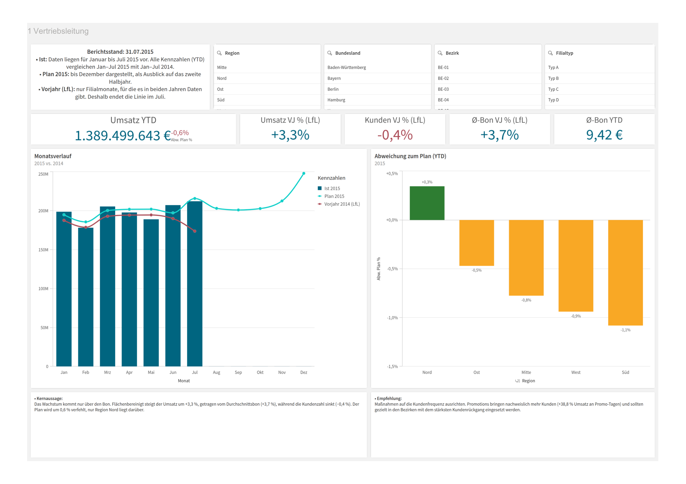
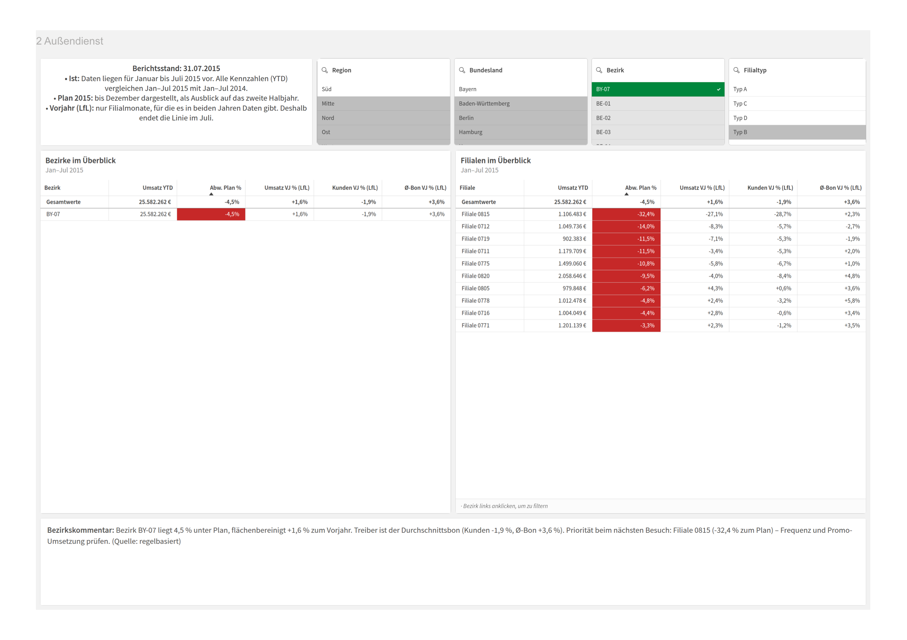

# Vertriebscontrolling-Cockpit Filialen (Qlik Sense)

*[English version](README.en.md)*

Portfolio-Projekt: Steuerungscockpit für die Vertriebsleitung und den Außendienst einer
Drogeriemarktkette auf Basis echter Filialdaten von **1.115 Rossmann-Filialen (2013–2015)**.
Von der Datenaufbereitung über Datenqualitätsprüfung und Datenmodell bis zum Qlik-Dashboard
mit Handlungsempfehlungen, ergänzt um KI-generierte Bezirkskommentare.

**Tools:** Qlik Sense (Ladeskript, Set Analysis, Master-Elemente) · Python (pandas) ·
SQL (SQLite, CTEs, Fensterfunktionen) · REST-API (Open-Meteo) · Claude API · uv · Git

## Fragestellungen

| Zielgruppe | Frage | Antwort im Dashboard |
|---|---|---|
| Vertriebsleitung | Liegen wir im Plan, und woher kommt das Wachstum? | Plan-Ist, Vorjahresvergleich, Zerlegung in Frequenz und Bon |
| Außendienst | Welche Filialen in meinem Bezirk brauchen Aufmerksamkeit? | Bezirks- und Filialranking mit Ampel, Bezirkskommentar |
| Category / Marketing | Wie wirken Aktionen, Wettbewerb, Wetter? | Promo-Uplift, Standortfaktoren |
| alle | Können wir den Zahlen trauen? | Datenqualitätsbericht |

## Ergebnisse und Handlungsempfehlungen

Berichtszeitraum: Januar bis Juli 2015 (YTD), Vergleich mit Januar bis Juli 2014.

1. **Wachstum nur über den Bon, die Frequenz sinkt.** Flächenbereinigt +3,3 % Umsatz zum Vorjahr,
   aber nur durch einen höheren Durchschnittsbon (+3,7 %). Die Kundenzahl sinkt um 0,4 %.
   → *Empfehlung:* Maßnahmen auf Kundenfrequenz ausrichten. Bezirke mit dem stärksten
   Kundenrückgang im Außendienst priorisieren (Blatt *Außendienst*).
2. **Plan knapp verfehlt (−0,6 %).** Nur Region Nord liegt über Plan (+0,3 %). Süd (−1,1 %) und
   West (−0,9 %) liegen am deutlichsten darunter. 41 von 60 Bezirken liegen unter Plan, in 36 Bezirken sinkt die Kundenzahl.
3. **Aktionen wirken vor allem über Frequenz.** An Promo-Tagen liegt der Umsatz je Filiale 38,8 %
   höher. Bei Filialtyp A ist der Effekt am größten (+43 % Umsatz, +26 % Kunden), bei Typ B am
   kleinsten (+18 %).
   → *Empfehlung:* Promo-Budget bevorzugt in Typ-A- und Typ-D-Filialen einsetzen. Da Aktionen
   Frequenz bringen, sind sie der direkte Hebel für Punkt 1.
4. **Dauerpromotion ohne erkennbaren Nutzen.** Filialen mit Dauerpromotion („Promo2“) machen
   11 % weniger Umsatz je Tag. Das ist vermutlich ein Auswahleffekt, weil eher schwächere
   Filialen teilnehmen, und kein Beleg für Wirkung.
   → *Empfehlung:* vor einer Ausweitung mit einem Test-/Kontrollgruppen-Vergleich prüfen.
5. **Wettbewerbsnähe = Innenstadtlage.** Filialen mit einem Wettbewerber im Umkreis von 500 m
   setzen am meisten um, haben aber den kleinsten Bon (8,05 € gegenüber 10,38 € bei über 10 km).
   → *Empfehlung:* In Innenstadtfilialen den Bon gezielt steigern, etwa über Zweitplatzierungen
   und die Kassenzone.
6. **Wetter hat kaum Einfluss.** An Regentagen liegt der Umsatz je Filiale nur 0,9 % niedriger
   (Wetterdaten aus der API). Für die Planung ist das kein relevanter Faktor.

## Dashboard

Aufbau in Qlik Sense Cloud, Schritt-für-Schritt-Anleitung: [`docs/qlik_anleitung.md`](docs/qlik_anleitung.md)

| Blatt | Inhalt |
|---|---|
| 1. Vertriebsleitung | KPIs, Monatsverlauf Ist/Plan/Vorjahr, Plan-Abweichung mit Drilldown Region → Bundesland → Bezirk → Filiale |
| 2. Außendienst | Ampel-Ranking der Bezirke und Filialen, Kommentar mit Handlungsempfehlung je Bezirk |
| 3. Einflussfaktoren | Promo-Uplift, Wochentag, Wettbewerbsnähe, Wetter |
| 4. Datenqualität | Prüfregeln und Ergebnisse, naiver vs. flächenbereinigter Vorjahresvergleich |

**Blatt 1 – Vertriebsleitung**



**Blatt 2 – Außendienst** (Auswahl: Bezirk BY-07)



## Architektur

```
Kaggle-CSV (Umsätze, Filialen)     Open-Meteo-API (Wetter)
            │                               │
            ▼                               ▼
   src/clean.py ── Datenqualitätsregeln ── dq_report
            │
   src/transform.py ── Region/Bezirk, Like-for-Like-Flags, Planung
            │
   src/load_to_db.py ── SQLite-Star-Schema (sql/schema.sql) + Integritätsprüfung
            │                     │
            │            sql/district_kpis.sql
            │                     │
            │            src/commentary.py ── Claude API / regelbasiert
            ▼                     ▼
      data/processed/qlik/*.csv  ──►  Qlik Sense (qlik/load_script.qvs)
```

Die Pipeline läuft mit einem Befehl, bricht bei Fehlern ab und protokolliert jeden Lauf in
`logs/pipeline.log`.

## Datenmodell in Qlik

```
        Filialen ───< Fakten >─── Kalender (Masterkalender)
   (Region, Bezirk)     │  Ist je Tag + Plan je Monat, verkettet, Feld "Datenart"
            │           │
 Bezirkskommentare      └──── Wetter   (Schlüssel Bundesland|Datum, per ApplyMap gebildet)

 Datenqualitaet (unverknüpft)
```

- **Verkettete Faktentabelle:** Ist (Tag) und Plan (Monat) haben verschiedene Granularität und
  liegen deshalb in einer Tabelle. So entstehen keine synthetischen Schlüssel, und es gibt einen
  gemeinsamen Kalender.
- **Kennzahlen als Variablen** (`$(vUmsatzAJ)`, `$(vUmsatzLfLVJ)` …) und als Master-Kennzahlen:
  einheitliche Definitionen für alle Blätter, die Basis für ein standardisiertes Berichtswesen.
- **Set Analysis** für YTD, Vorjahr, Like-for-Like und Plan, unabhängig von der Zeitauswahl.

## Datenqualität

Zwölf Prüfregeln laufen bei jedem Pipeline-Lauf. Das Ergebnis erscheint im Dashboard.
Die wichtigsten Befunde:

| Befund | Umgang |
|---|---|
| **Alle 180 bayerischen Filialen** haben keine Daten für Jul–Dez 2014 | Like-for-Like-Vergleich. Ohne Bereinigung zeigt 2014 einen Umsatzrückgang von −5,3 % (tatsächlich +2,8 %), Bayern 2015 ein Plus von +22,9 % (tatsächlich +4,0 %). |
| 54 Tage „geöffnet“ mit Umsatz 0 | entfernt, sonst wird der Tagesdurchschnitt verzerrt |
| 22 Filialen mit Bundesland „HB,NI“ | Niedersachsen zugeordnet und markiert |
| Wettbewerber-Eröffnung im Jahr 1900 | als Platzhalter erkannt und geleert |
| 1.113 Ausreißer-Tage | markiert, nicht gelöscht |

Nach dem Laden prüft die Pipeline außerdem die referentielle Integrität: Jeder Umsatz hat eine
Filiale, ein Datum und einen Wetterwert.

## KI-gestützte Bezirkskommentare

`src/commentary.py` schreibt für jeden der 60 Bezirke einen Kommentar mit drei Sätzen: Lage,
Ursache und Handlungsempfehlung. Im Außendienst-Blatt erscheint er für den ausgewählten Bezirk.

- **Zahlen rechnet der Code, nicht das Modell:** Die Kennzahlen kommen per SQL
  (`sql/district_kpis.sql`). Das Sprachmodell bekommt nur die fertigen Werte als JSON und
  formuliert daraus Text. So kann es keine Zahlen erfinden.
- **Prompt mit festen Regeln:** Rolle, Zielgruppe, Satzstruktur, Zerlegung in Frequenz und Bon,
  Verbot unbelegter Ursachen (siehe `SYSTEM_PROMPT`).
- **Fallback:** Ohne API-Schlüssel entstehen regelbasierte Kommentare, damit das Dashboard immer
  vollständig ist. Die Spalte *Kommentar Quelle* zeigt im Dashboard, ob ein Text von der KI oder
  von den Regeln stammt.
- **Datenschutz:** An die API gehen nur aggregierte Bezirkskennzahlen, keine personenbezogenen Daten.

## Datenquelle

| Datei | Quelle |
|---|---|
| `train.csv`, `store.csv` | Kaggle-Wettbewerb [Rossmann Store Sales](https://www.kaggle.com/competitions/rossmann-store-sales/data) |
| `store_states.csv`, `state_names.csv` | Bundesland je Filiale, Community-Ergänzung zum Wettbewerb (u. a. im [fast.ai-Archiv](https://files.fast.ai/part2/lesson14/rossmann.tgz)) |
| `weather_api.csv` | [Open-Meteo Historical Weather API](https://open-meteo.com/en/docs/historical-weather-api), wird von der Pipeline geladen |

Die Rohdaten aus Kaggle sind nicht im Repo, sie müssen nach `data/raw/`.

> **Simulierte Werte:** Die **Außendienst-Bezirke** (ca. 20 Filialen je Bezirk innerhalb eines
> Bundeslandes) und die **Planwerte 2015** sind simuliert und keine echten Rossmann-Daten:
> Plan = Vorjahresmonat × (1 + Zielwachstum der Region, 3–5 %). Fehlt der Vorjahresmonat,
> dient der Monat 2013 als Basis, hochgerechnet mit dem flächenbereinigten Wachstum 2014.

## Setup und Ausführung

Voraussetzung: [uv](https://docs.astral.sh/uv/) ist installiert, die Rohdaten liegen in `data/raw/`.

```bash
uv sync                              # Abhängigkeiten installieren
uv run python src/run_pipeline.py    # komplette Pipeline (ca. 20 Sekunden)

# optional: Bezirkskommentare mit Claude statt regelbasiert
export ANTHROPIC_API_KEY=...
uv run python src/commentary.py

# SQL-Analysen zu den Ergebnissen oben
sqlite3 -header -column data/processed/sales.db < sql/analysen.sql
```

## Projektstruktur

```
src/            Pipeline (extract_weather, clean, transform, load_to_db, commentary, run_pipeline)
sql/            schema.sql (Star-Schema), district_kpis.sql (KI-Input), analysen.sql
qlik/           load_script.qvs (Qlik-Ladeskript)
docs/           qlik_anleitung.md, screenshots/
data/raw/       Rohdaten (nicht versioniert, außer Wetter-Cache)
data/processed/ erzeugte Daten, Datenbank, Qlik-Exporte (nicht versioniert)
```
